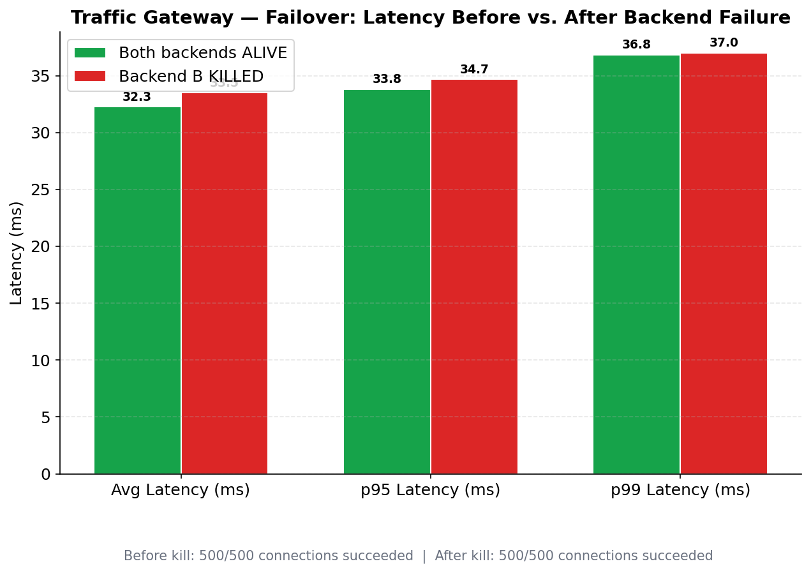
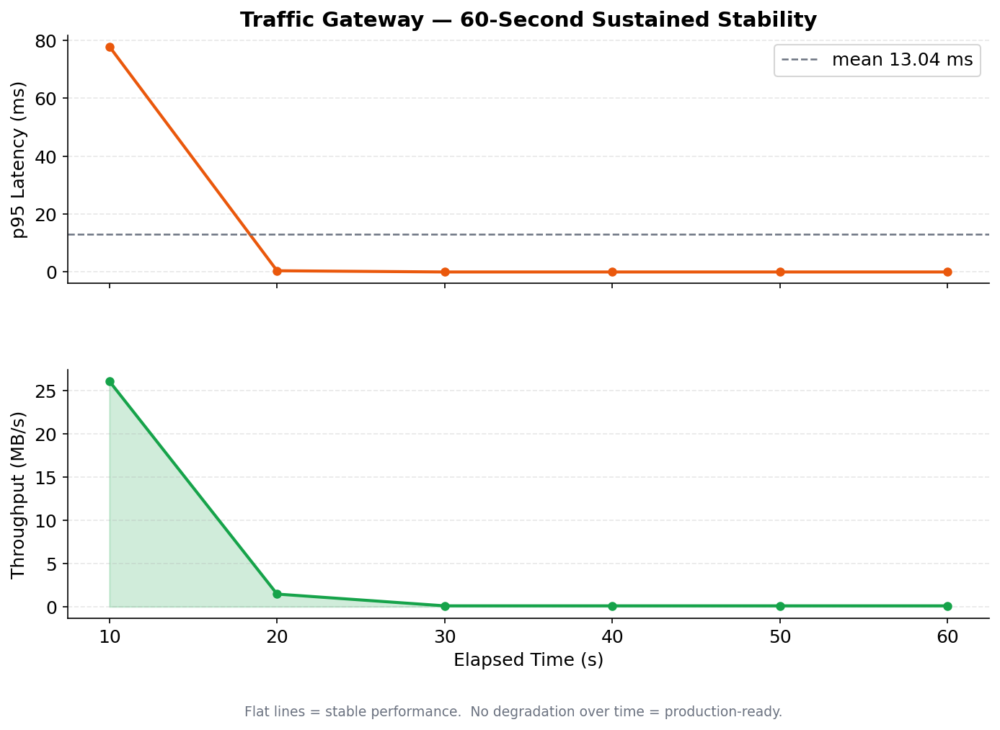

# 9. Scale & efficiency

One epoll‑driven event loop handles thousands of connections in a few MB of RAM.
For more cores, it also runs as N worker processes sharing the same port
(`SO_REUSEPORT`, kernel‑balanced). Memory is bounded even under abuse (backpressure
+ a hard `max_connections` cap).

### Multi‑process (optional, live)
```bash
# Stop the single-process gateway (Ctrl+C in Terminal 2), then:
./build/sluice config/demo_mp.json          # worker_processes: 4
pgrep -af 'sluice config/demo_mp.json'       # 1 master + 4 workers
```
All four workers accept on `:9000`; the kernel spreads connections across them.
(Then Ctrl+C and restart `./build/sluice config/demo.json` if you continue.)

---

### Benchmark results

**Resource usage during a full load run** — RAM stays flat at ~5–6 MB while open
connections (FDs) spike into the thousands. Flat memory = no leak, and proof of the
epoll design.


**Scalability** — every load level from 100 to **10,000** concurrent connections
completed with **zero failures**.


**Failover under load** — a backend is killed mid‑test; throughput barely moves and
**no requests fail**.



**Sustained load** — 1,000 connections held for 60s with stable memory (no leak).



| Test | Result |
|---|---|
| 100 → 10,000 connections | 0 failed at every level |
| Memory footprint | ~5–6 MB throughout |
| Failover (500 conns, backend killed) | 0 failed before **and** after |
| Sustained (1,000 conns, 60s) | 0 failed, flat memory |

← [previous](08-rate-limiting.md) · next → [Production deployment](10-production.md)
