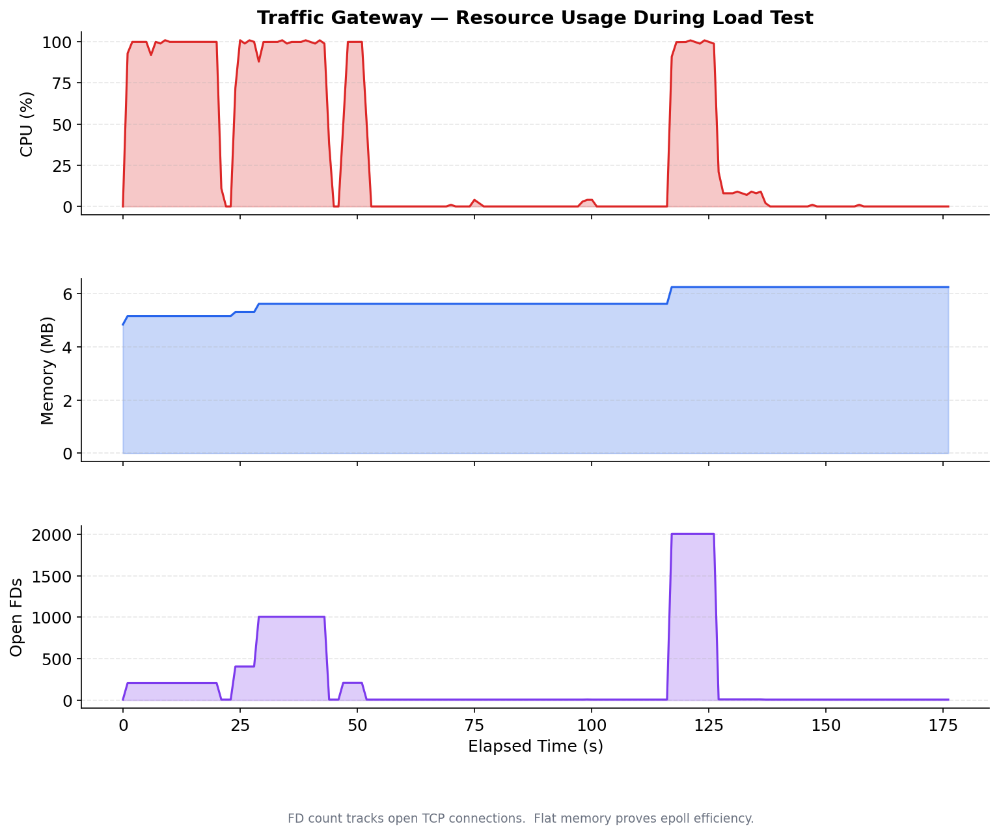
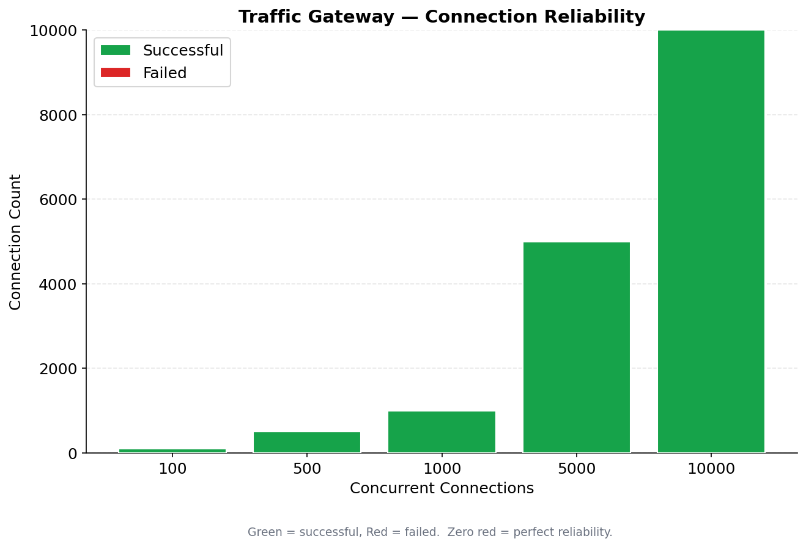

# 8. Scale & Production

### Benchmark results

| Concurrent connections | Success rate | Memory (gateway) |
|---|---|---|
| 100 | 100% | ~5 MB |
| 500 | 100% | ~5 MB |
| 1,000 | 100% | ~5 MB |
| 5,000 | 100% | ~6 MB |
| 10,000 | **100%** | **~6 MB** |




### Multi-process mode
Ctrl+C the gateway, then:
```bash
./build/sluice config/demo_mp.json
pgrep -af sluice
for i in $(seq 1 20); do curl -s -o /dev/null -w "%{http_code} " http://127.0.0.1:9000/ & done; wait; echo
```

### Production deployment
```bash
systemctl status sluice
ps -o user= -p "$(systemctl show -p MainPID --value sluice)"
systemctl reload sluice
```

---

← [UDP PROXY Protocol v2](07-udp-proxy-protocol.md) · [back to index](00-index.md)
